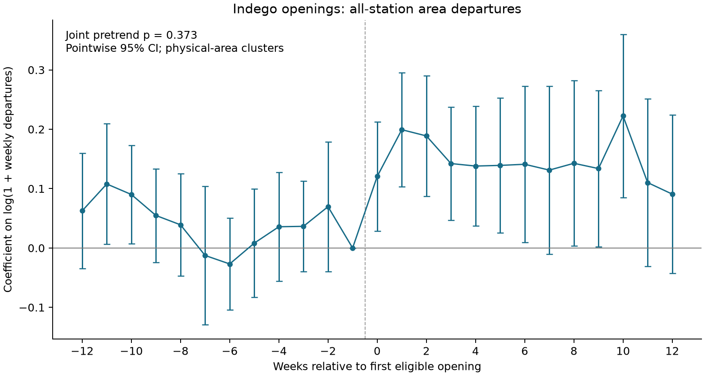
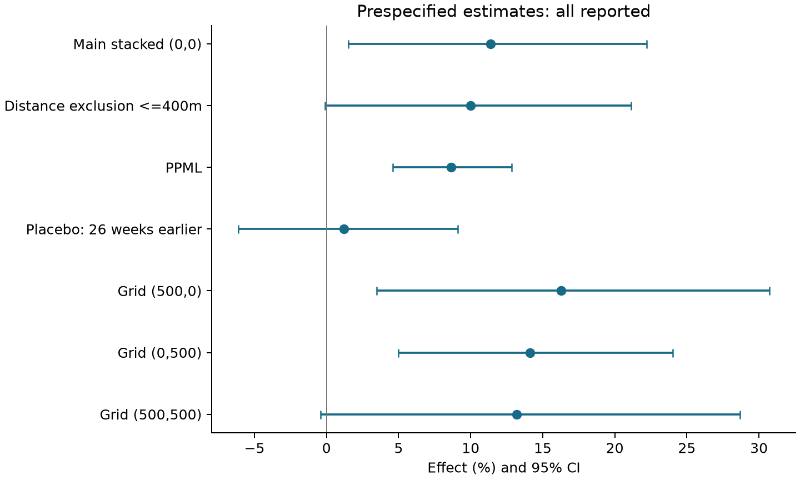
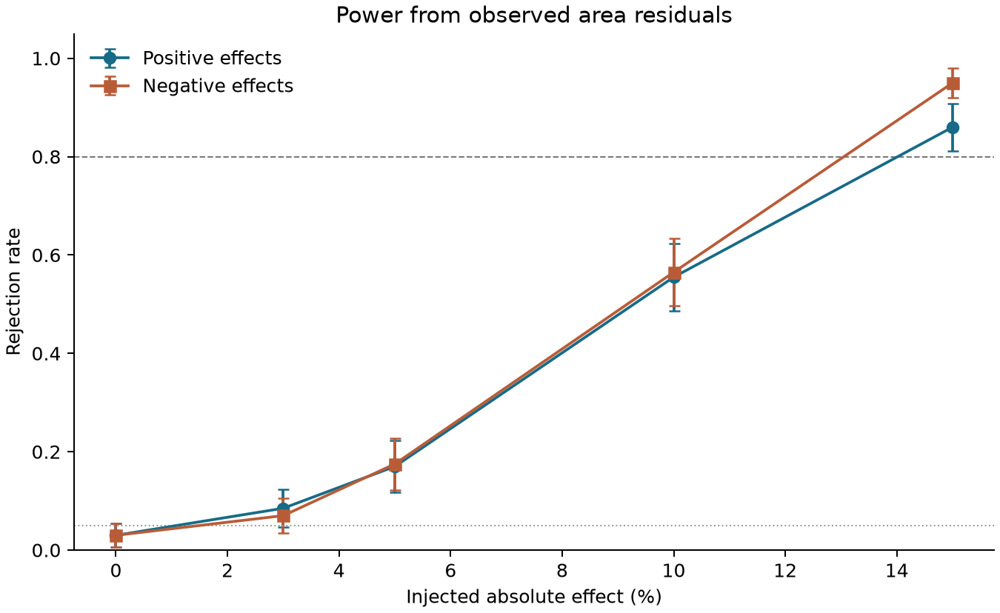

# Preregistered area-level analysis

Prediction and final specification committed before area outcomes in [8bb670b](https://github.com/Anran0716/indego-station-impact/commit/8bb670b05303304c4579c72941ae915b0694b9bc). Prediction: +5% net all-station area departures in event weeks 0–12. The main grid, cohorts, control rules and thresholds were fixed before fitting.

## Main estimate and prespecified variants

The primary outcome is log(1 + departures from all stations inside a qualified area). Qualified-old departures are secondary. The sample includes newly opened stations; the primary question concerns net local ridership, not only diversion. Pooled stacked estimates use stack-area and stack-week FE, physical-area clusters, full-rank CR1 and t(G-1) inference. Pooled and event-average summaries have different weighting and need not coincide. Log1p percentage transformations refer to 1+departures; PPML refers to expected departure counts.

| Specification | Effect | 95% CI | p-value | Physical clusters | Rows |
| --- | ---: | --- | ---: | ---: | ---: |
| Main stacked (0,0) | +11.4% | [+1.5%, +22.2%] | 0.02373 | 49 | 8109 |
| Qualified-old secondary | -8.3% | [-15.8%, -0.2%] | 0.04564 | 49 | 8109 |
| Distance exclusion <=400m | +10.0% | [-0.1%, +21.1%] | 0.05254 | 49 | 7244 |
| PPML | +8.7% | [+4.6%, +12.9%] | 5.98e-05 | 49 | 8109 |
| Placebo: 26 weeks earlier | +1.2% | [-6.1%, +9.1%] | 0.7495 | 44 | 5404 |
| Grid (500,0) | +16.3% | [+3.5%, +30.7%] | 0.01244 | 51 | 7399 |
| Grid (0,500) | +14.1% | [+5.0%, +24.0%] | 0.002529 | 53 | 7565 |
| Grid (500,500) | +13.2% | [-0.4%, +28.7%] | 0.05738 | 53 | 8791 |

Under the registered identification assumptions, higher all-station area ridership alongside lower qualified-old ridership is consistent with net local growth and partial redistribution from existing stations. Aggregate estimates do not track individual riders or directly identify a transfer fraction. Nonplacebo robustness point estimates are positive across specifications; the time-placebo estimate is small and compatible with zero, rather than proof that no pre-opening confounding exists.

## Event study and identification



Joint pretrend test, event weeks -12..-2: F(11,48) = 1.112, p = **0.3727**.
The pretrend test does not reject at 5%. This does not establish parallel trends, no anticipation, or random station placement.

Secondary event-study average, weeks 0..12: log coefficient 0.14615, 95% CI [0.04215, 0.25016], p = 0.006858. Transformed: +15.7% [+4.3%, +28.4%]. This average uses the full event covariance, not an average of standard errors. It is a prespecified secondary contrast relative to week -1, **not the headline net-growth estimate**.

The event-study average is relative to week -1, which sits below the pre-period mean; relative to the full pre-period the post average is about +11%, consistent with the pooled estimate.

For clarity, the mean coefficient over weeks -12..-2 is 0.04227. Including the zero reference coefficient for week -1, the full 12-week pre-period mean is 0.03875. Subtracting that full pre-mean from the post mean gives 0.10741 log units, or **+11.3%**. Excluding the reference week from the pre-mean gives +10.9%. These are explicitly post-result reference diagnostics, computed from the saved coefficients and their full covariance; no model was refitted or reference week changed. The pooled estimator compares post observations with the whole pre-period using its regression weights, reducing reliance on any one low week. It need not equal an arithmetic event-time contrast exactly.

Descriptively, weeks 1–2 average 0.194 in log coefficients relative to week -1, while weeks 3–12 average 0.139 with week-to-week fluctuations. This early bump is compatible with a transient opening response or novelty, but the curve alone does not identify that mechanism. These log coefficients are not percentage-point changes.

## Robustness and sample support



The <=400m exclusion is the registered distance rule, requiring >=10 controls in every stack. PPML uses the same count sample/FE and physical clusters; its IRLS convergence and score diagnostics are in `ppml_diagnostics.json`. No zero counts or separated observations are silently removed. Every fixed grid is reported, with (0,0) retained as primary regardless of its estimate.

The time placebo shifts treatment and windows 26 weeks earlier and reuses original clean controls. Only complete shifted cohorts inside the observed panel are estimable; omitted placebo cohorts: 2022Q2, 2022Q3. This support restriction does not omit any main cohort. See `placebo_support.json`.

The following nonplacebo intervals include zero: Distance exclusion <=400m, Grid (500,500). Positive point estimates across these specifications should be read with their differing uncertainty; the report does not label all robustness results as passed.

## Empirical-residual power (replaces synthetic example)



Unrestricted main-model residuals are scaled by sqrt(N/(N-K)). The fitted pooled effect is removed, nuisance FE retained, and one Rademacher sign is shared by all rows/weeks/stack copies of each physical area. Inject log(1+delta) and refit the same stacked/CR1 test. Use 200 common-sign draws per effect, seed 20261122. This uses observed residual magnitudes and within-area dependence; it is conditional design power, not an unconditional forecast or proof of causal identification. Residuals may contain heterogeneous effects and omitted shocks.

| Injected effect | Rejection rate | MC SE | 95% coverage |
| --- | ---: | ---: | ---: |
| +0% | 3.0% | 1.2% | 97.0% |
| +3% | 8.5% | 2.0% | 97.0% |
| +5% | 17.0% | 2.7% | 97.0% |
| +10% | 55.5% | 3.5% | 97.0% |
| +15% | 86.0% | 2.5% | 97.0% |
| -3% | 7.0% | 1.8% | 97.0% |
| -5% | 17.5% | 2.7% | 97.0% |
| -10% | 56.5% | 3.5% | 97.0% |
| -15% | 95.0% | 1.5% | 97.0% |

Smallest tested positive absolute effect reaching 80% rejection: **15%**.

Smallest tested negative absolute effect reaching 80% rejection: **15%**.

These are coarse tested-effect thresholds with Monte Carlo uncertainty, not interpolated MDEs. The 0% row estimates the null rejection rate. The [synthetic simulation](../area_simulation/README.md) remains an archived code validation; its assumed-noise power is superseded by this empirical analysis.

## Magnitude uncertainty and Type M risk

With 55.5% power at an assumed +10% effect, statistically significant estimates can exaggerate magnitude when attention is conditioned on significance. This is the conditional Type M/exaggeration risk described by [Gelman and Carlin](https://sites.stat.columbia.edu/gelman/research/published/retropower20.pdf). It does not, by itself, establish that this particular +11.4% estimate is too large, or justify replacing its interval with a narrower subjective range.

Post-result illustration using only the already saved +10% bootstrap scenario: 111/200 draws are significant. Among those draws, the mean transformed estimate is +13.6%; the conditional mean absolute log-magnitude ratio is **1.34** relative to the assumed true log effect. This calculation is conditional on a true +10% effect and this empirical-residual bootstrap; it is not a shrinkage correction or a posterior probability about the observed effect.

Interview wording: "The results are consistent with positive net area growth alongside diversion from existing stations. Every prespecified nonplacebo robustness variant for the all-station outcome has a positive point estimate. Given only about 56% power at +10%, I would describe a positive effect on roughly a 10% scale with substantial uncertainty, rather than claim precisely 11%." The full primary 95% interval remains +1.5% to +22.2%, with some robustness intervals including zero.

## Limitations

The main estimate assumes no cross-boundary spillover. The eight-neighbour exclusion test was not estimable because nearly every control area borders a treated area. The 400-metre distance-based exclusion test is estimable, retaining at least 17 control areas in every stack across all four preregistered grid offsets.

Station placement can follow local demand changes. All-station area totals include within-cell diversion, while cross-boundary changes can bias estimates in either direction. The four offsets change which openings/old stations share a cell, so their estimates answer related but not identical spatial questions. An opening week is only partially exposed. One treated cell has earlier outside-window exposure; the precommitted timing diagnostic was retained, not used as a post-hoc exclusion. The secondary old-station pool was selected using the registered baseline/inactivity rules. This is one city's network expansion.

## Audit and reproduction

`panel_audit.csv` reconciles all cleaned departures inside/outside each study grid. Zero area-weeks are retained. Canonical IDs and fixed positions are used for every station, including new ones. Raw trips and full panels remain ignored. Input hashes, software versions, exact coefficients and diagnostics are in `summary.json`; `all_estimates.csv` and `event_covariance.csv` provide full precision.

```powershell
python -m pip install -e '.[dev]'
python scripts/run_area_analysis.py --prereg-commit 8bb670b05303304c4579c72941ae915b0694b9bc
# For an existing verified station-week cache, append --reuse-weekly-cache
```
